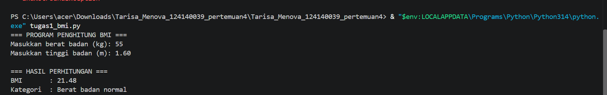
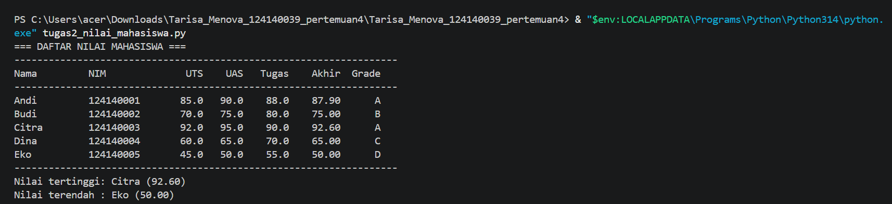
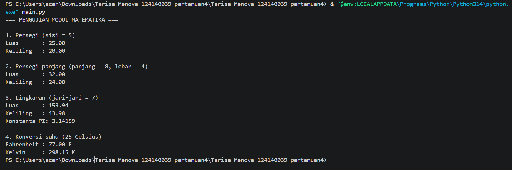

# Praktikum Dasar Pemrograman Python – Pertemuan 4

## Identitas Mahasiswa
- **Nama:** Tarisa Menova
- **NIM:** 124140039
- **Kelas:** RA
- **Mata kuliah:** Dasar Pemrograman Python

## Deskripsi Program

1. **`tugas1_bmi.py`**: menerima berat badan dan tinggi badan, menghitung BMI, lalu menentukan kategori menggunakan `if-elif-else`.
2. **`tugas2_nilai_mahasiswa.py`**: menyimpan data lima mahasiswa dalam list berisi dictionary, menghitung nilai akhir berbobot, menentukan grade, menampilkan tabel, serta mencari nilai tertinggi dan terendah.
3. **`math_operations.py`**: modul berisi konstanta `PI`, fungsi luas dan keliling persegi, persegi panjang, lingkaran, serta konversi Celsius ke Fahrenheit dan Kelvin.
4. **`main.py`**: program utama yang menguji semua fungsi pada modul. Program menerapkan `import math_operations` dan `from math_operations import ...`.

## Cara Menjalankan

Pastikan Python 3 sudah terpasang. Buka terminal pada folder proyek, lalu jalankan:

```bash
python tugas1_bmi.py
python tugas2_nilai_mahasiswa.py
python main.py
```

Jika perintah `python` tidak tersedia, coba gunakan `python3` (macOS/Linux) atau `py` (Windows).

## Bukti Screenshot Eksekusi

### Soal 1 - Program BMI



### Soal 2 - Data Nilai Mahasiswa



### Soal 3 - Modul Matematika



## Struktur Folder

```text
Tarisa_Menova_124140039_pertemuan4/
├── .gitignore
├── README.md
├── tugas1_bmi.py
├── tugas2_nilai_mahasiswa.py
├── math_operations.py
├── main.py
└── screenshots/
    ├── soal1_bmi.png
    ├── soal2_nilai_mahasiswa.png
    └── soal3_modul_matematika.png
```
